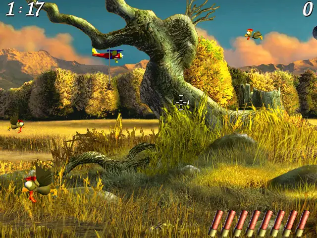

# Moorhuhn 2

A remake of Moorhuhn 2, built with C++23 and SDL3.

Hunt chickens across the scrolling countryside, discover hidden bonuses,
and score as many points as you can before the 90-second timer runs out.



## Play

Extract the ZIP, then start the game:

- **Linux x86_64:** run `./moorhuhn2`.
- **Windows x86_64:** run `moorhuhn2.exe`, keeping the supplied DLLs and asset packages beside it.
- **macOS 13.3+:** open `Moorhuhn2.app`. Choose arm64 for Apple Silicon or x86_64 for Intel.

The game starts fullscreen at a logical resolution of 640×480, with at most 60 updates per second.

## Controls

| Control | Action |
| --- | --- |
| Mouse | Aim; move to the left or right screen edge to scroll |
| Left click | Shoot; release to select a menu item |
| Right click | Reload when the magazine is empty |
| Left / Right arrow | Scroll the view |
| Space / Left click | Skip the title animation; press again to start a round |
| B | Open the boss screen and pause; press again to resume |
| Escape | End a round, leave a menu or exit from the title screen |
| Enter | Confirm a highscore name, up to eight characters |
| Up / Down + Enter | Select an item in Extras; the mouse also works |

## Game features

- **Depth scoring:** ordinary chickens are worth 5, 10 or 25 points depending on distance.
- **Eight-shot magazine:** reload only when empty; scenery bonuses can increase capacity.
- **Moving targets:** flying chickens, large chickens, balloons, airplanes and blimps.
- **Aircraft arrivals:** airplanes and blimps are chosen by random spawn rolls throughout
  the round, with at most one of each active. There is no fixed arrival time.
  The third airplane hit costs 25 points; shooting a blimp costs 35.
- **Interactive scenery:** stones, branches, tree crowns, the spider, frog, scarecrow,
  hunting stand, boat, village buildings and a hidden chicken.
- **Highscores:** scores, accuracy, tie ordering and the eight-letter name limit follow the original.
  Quick successive hits can earn combo bonuses.

## Original secrets (spoilers)

- **Eight stones:** unlock special ammunition and release 16 balloons.
- **Four branches:** increase the magazine to ten shots on the next reload.
- **Rose timing:** hit it in the first five seconds for five extra seconds,
  or in the last five seconds for 50 points.
- **Scarecrow order:** remove its seven scored pieces in the correct order for
  24 balloons; another order releases ten chickens.
- **Balloon hero:** pop 25 balloons for 100 bonus points and six large chickens.
- **House 88:** after hitting the house, shoot the rose with exactly 88 points
  and 60–65 seconds remaining to activate denser spawns and a 16-shot magazine.

## Remake extras

The new **Extras** entry on the title screen provides access to restored bonus
content:

- **Snake:** restored bonus game. Space starts; arrow keys steer; Escape returns.
- **Making-of:** restored credits screen with a mouse-reactive portrait.
  A highscore named `Witan` switches it to the animated logo. Escape, Space or
  left click returns to Extras.

Snake and Making-of use content found in the original game, accessible through
the new Extras menu. The original computer-channel screen remains available
through the blue arrow at the bottom left of the title.

## Saves

Highscores are saved when you leave the highscore table and when you quit. On Linux,
the file is `${XDG_DATA_HOME:-$HOME/.local/share}/Moorhuhn2/Moorhuhn2/moorhuhn2.sav`.

## Build from source

Requires CMake 3.25+, Ninja, Make, Python 3.11+ and a C++23 compiler.
SDL dependencies are downloaded on the first build and cached under `build/dependencies/`.
On Linux, SDL needs the X11, Wayland, audio and graphics development packages listed in
[the nightly workflow](.github/workflows/nightly.yml); `make check` also needs Xvfb,
xdpyinfo, xdotool, Openbox, xprop, ImageMagick and Pillow for its native checks.

```sh
make run
```

`make release` creates ZIPs for the current platform. See [packaging](tools/packaging/README.md).
